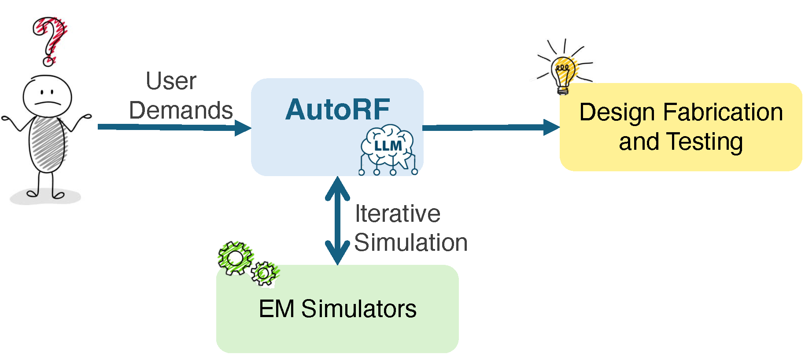
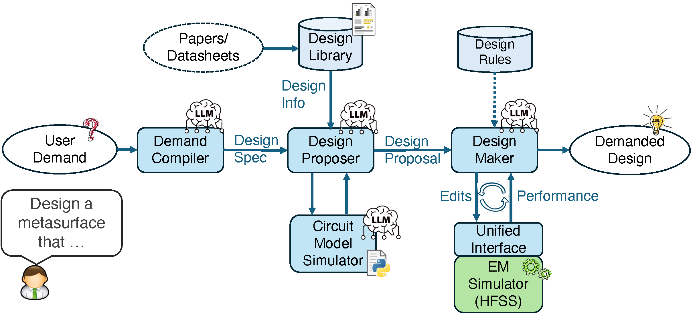

# LLM4Surf

**An agentic LLM framework for automated RF hardware design — starting with metasurfaces and antennas.**

[](LICENSE)
[](https://www.python.org/)

LLM4Surf turns a **natural-language design request** into a **RF
hardware design**. Instead of training a large task-specific neural network on
tens of thousands of expert-crafted samples, it uses the reasoning and few-shot
learning abilities of Large Language Models (LLMs) to drive a circuit-model
simulator and a full-wave electromagnetic (EM) simulator, iterating on a small
library of design templates until the target specification is met.

<p align="center">
  
</p>

---

## Table of contents

- [What it does](#what-it-does)
- [How it works](#how-it-works)
- [Repository structure](#repository-structure)
- [Prerequisites](#prerequisites)
- [Installation](#installation)
- [Configuration](#configuration)
- [Running a demo](#running-a-demo)
- [Extending the framework](#extending-the-framework)
- [Notes & limitations](#notes--limitations)
- [Citation](#citation)
- [License](#license)

---

## What it does

Given a demand such as:

> *"Design a reflective passive metasurface for 120 GHz sub-THz wireless coverage
> enhancement, using paper as substrate."*

LLM4Surf produces a parameterized design and the corresponding HFSS project. From
a handful of representative templates it can cover a wide design space, including:

- **Operating frequency** from ~900 MHz to 160 GHz (and sub-THz)
- **Substrate materials** (e.g., FR4, paper, Rogers, air gap) — determining the
  fabrication process and cost
- **Single-** or **multi-layer** surfaces
- **Phase** and **amplitude** control
- **Reflective** and **transmissive** surfaces
- **Passive** and **programmable (active)** surfaces
- **Antennas** (e.g., patch antennas), showing generalization beyond metasurfaces

## How it works

<p align="center">
  
</p>

LLM4Surf structures hardware design into **layered abstractions** — from
high-level demands, to design specifications, to circuit models, to concrete
parameterized designs — because LLMs reason most reliably within a single level
of abstraction. The pipeline consists of three LLM-driven modules plus two design
tools:

| Stage | Module | Role |
|-------|--------|------|
| 1. Demand → Spec | **Demand Compiler** (`modules/demand_translator.py`) | Translates a free-form demand into a structured hardware specification. |
| 2. Spec → Proposal | **Design Proposer** (`modules/design_proposer.py`) | Selects the closest template from the design library and proposes a design strategy, aided by a lightweight **Circuit Model Simulator** (`modules/circuit_model_simulator.py`). |
| 3. Proposal → Design | **Design Maker** (`modules/design_maker.py`) | Iteratively edits the design, runs the **EM simulator (HFSS)** via `modules/hfss_manager.py`, and refines until the spec is met or the iteration budget is exhausted. |

Supporting components include a **design-rule database**
(`modules/rules_and_constrains.py`), a **design reviewer**
(`modules/design_reviewer.py`) for reliability, and a **literature learner**
(`modules/literature_learner.py`) that builds template summaries.

## Repository structure

```
llm4surf/
├── main.py                     # Entry point: end-to-end design automation
├── prepare_design_lib.py       # Build/refresh the design-library summaries
├── get_started.py              # Minimal HFSS/AEDT connectivity smoke test
├── requirements.txt
├── configs/
│   ├── system_config.yaml      # Model, paths, simulation & optimization settings
│   ├── user_demands.yaml       # Example natural-language demands
│   └── prompt_templates/       # Prompt templates used by the modules
├── modules/                    # Core framework
│   ├── demand_translator.py    # Demand Compiler
│   ├── design_proposer.py      # Design Proposer
│   ├── design_maker.py         # Design Maker
│   ├── circuit_model_simulator.py
│   ├── hfss_manager.py         # PyAEDT-based EM-simulator control
│   ├── design_reviewer.py / design_tuner.py / design_evaluator.py
│   ├── surface_spec_def.py / design_info_def.py / rules_and_constrains.py
│   └── utils/                  # LLM interface, prompt/config managers, logging
├── circuit_model/              # Circuit-model simulator library + cached profiles
├── design_library/
│   ├── metasurface_designs.yaml
│   └── design_summary/         # Pre-built template summaries (*.pkl)
├── HFSS_workspace/
│   └── design_templates/       # HFSS (.aedt) starting-point templates
└── docs/figures/               # Figures used in this README
```

## Prerequisites

1. **Python 3.12+** — the code uses recent syntax features.
2. **LLM access** — at least one supported backend (see [Configuration](#configuration)):
   OpenAI, Azure OpenAI, or OpenRouter.
3. **Ansys HFSS 2024 R2** (recommended) — required for the full-wave EM
   simulation loop, driven through the [PyAEDT](https://aedt.docs.pyansys.com/)
   package. HFSS runs on Windows and needs a valid Ansys license.
   Older versions (e.g., 2022 R1) may not fully support the Python API.

> You can explore and develop the non-EM parts (demand compiling, design
> proposing, circuit-model simulation) without HFSS. The full design-maker loop
> requires HFSS.

## Installation

```bash
# 1. Clone
git clone https://github.com/Rui-Chun/llm4surf.git
cd llm4surf

# 2. Create and activate a virtual environment
python -m venv .venv
source .venv/bin/activate          # Windows: .venv\Scripts\activate

# 3. Install dependencies
pip install -r requirements.txt
```

## Configuration

### 1. LLM backend & API keys

The framework selects a backend through
`GetLLMInterface(model_name, model_provider)` in
`modules/utils/llm_interface.py`. Supported providers: `"OpenAI"` and
`"OpenRouter"`.

Copy the example env file and fill in the credentials for the backend(s) you use:

```bash
cp .env.example .env
# then export them into your shell, e.g.:
export OPENAI_API_KEY="sk-..."
export OPENROUTER_API_KEY="sk-or-..."
```

- **OpenAI** — the OpenAI SDK reads `OPENAI_API_KEY` automatically.
- **OpenRouter** — set `OPENROUTER_API_KEY`.
- **Azure OpenAI** — the [Azure OpenAI Service](https://learn.microsoft.com/en-us/azure/ai-foundry/openai/supported-languages)
  exposes an OpenAI-compatible API. Because the OpenAI SDK also honors
  `OPENAI_BASE_URL`, you can reuse the `"OpenAI"` backend by pointing it at your
  Azure deployment: set `OPENAI_BASE_URL="https://YOUR-RESOURCE.openai.azure.com/openai/v1/"`,
  `OPENAI_API_KEY` to your Azure key, and use your deployment name as the model name.

> **Never commit API keys.** `.env` and `api_keys.txt` are gitignored.

### 2. System settings

Edit `configs/system_config.yaml` to adjust the model, simulation limits
(`max_iterations`, `timeout`), the HFSS version, and optimization weights.

The HFSS workspace defaults to the `HFSS_workspace/` folder inside the repo. You
can override it with the `LLM4SURF_HFSS_WORKSPACE` environment variable.

## Running a demo

By default `main.py` uses OpenAI (reads `OPENAI_API_KEY`). To use a different
backend, change the interface selection in
`MetasurfaceDesignAutomation.__init__`:

```bash
python main.py
```

By default `main.py` runs the first demand from `configs/user_demands.yaml`. To
try your own, edit the demand string in `main.py`:

```python
user_demand = "Design a reflective passive metasurface for 77-81 GHz mmWave radars, using paper as substrate."
optimized_design = design_system.automate_design(user_demand)
```

The most reliable use case today is **adapting the operating frequency band of a
reflective passive metasurface**.

### Quick component tests

You can sanity-check individual pieces by running their `__main__` blocks:

```bash
python modules/utils/llm_interface.py   # verify LLM access
python modules/hfss_manager.py          # verify PyAEDT/HFSS control (needs HFSS)
python get_started.py                   # minimal AEDT connectivity check
```

## Extending the framework

- **Add a design template** — place an HFSS `.aedt` template in
  `HFSS_workspace/design_templates/`, then generate its summary with
  `prepare_design_lib.py` so the Design Proposer can select it.
- **Add design rules** — extend `modules/rules_and_constrains.py` to guide the
  Design Maker with domain constraints.
- **Add specification fields** — extend `modules/surface_spec_def.py` to describe
  new hardware capabilities.

## Notes & limitations

- HFSS/AEDT is commercial software; a valid Ansys license is required for the EM
  simulation loop.
- LLM outputs are stochastic; results may vary between runs and models. The
  design reviewer and iteration loop mitigate but do not eliminate this.
- This is a research prototype. Always verify generated designs before
  fabrication.


## License

Released under the [MIT License](LICENSE).
